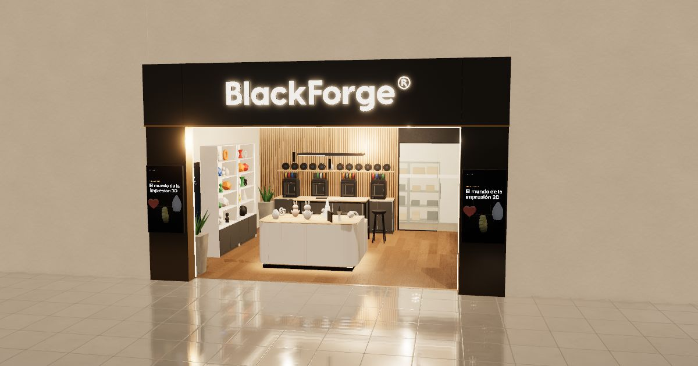

<h1 align="center">
  <picture>
    <source media="(prefers-color-scheme: dark)" srcset="assets/blackforge-logo.svg">
    
  </picture>
</h1>

<b>Una maqueta 3D de la tienda BlackForge: gírala con el dedo, toca un mueble y te cuenta de qué está hecho, cómo se arma y cuánto cuesta.</b>

  
  
  
  

## ¿Qué es esto?

BlackForge es una tienda-taller de impresión 3D de 6 × 7 metros, donde unas máquinas fabrican juguetes y objetos capa
por capa; todavía no existe, y esta página permite recorrerla en 3D antes de construirla. Cada uno de sus 20 muebles
se puede abrir para ver de qué está hecho, cómo se fabrica, cómo se arma y cuánto cuesta. Montar la tienda completa
cuesta **$38.788.078** en materiales y equipos, y la página muestra a dónde va cada peso.

## Ábrelo en 30 segundos

| Dónde | Cómo | Bueno saber |
|---|---|---|
| **En línea** | Abre **[blackmkount.github.io/local-3d](https://blackmkount.github.io/local-3d/)** | Funciona en el computador, la tableta y el teléfono. |
| **En tu computador, con un servidor** | `npm ci` la primera vez, luego `npm start` (o `python3 -m http.server 8000`) y abre <http://localhost:8000> | Igual que en línea, también sin internet. |
| **Con doble clic** | Descarga el repositorio y abre `index.html` | Funciona sin internet; las pantallas de video del local se ven como imagen fija. |

Necesita un navegador reciente con WebGL 2: Chrome, Edge, Firefox o Safari. Si un equipo antiguo va lento, añade
`?lite` al final de la dirección.

## Qué puedes hacer

<!-- CAPTURAS PENDIENTES: las imágenes de docs/img/ se toman con la interfaz final (npm run og). Al tomarlas, borra esta línea. -->

| | |
|---|---|
|  | **Toca un mueble** y se abre su ficha: qué es, de qué materiales está hecho, cómo se hace, cómo se arma y por qué se eligió cada material. Al pasar por un material, sus piezas brillan en el modelo. |
|  | **Separar piezas**: el mueble se abre en todas sus piezas, como un LEGO desarmado. |
|  | **Ver cómo se arma**: las piezas vuelven a su sitio paso a paso, cada una con su explicación. |
|  | **Modo explorador o experto**: el explorador explica con palabras sencillas (¿Qué es? ¿Para qué sirve? ¿Sabías que…?) y trae preguntas; el experto muestra todo el detalle técnico. Lo técnico nunca queda a más de un toque, en «Para expertos». |
|  | **¿Cómo nace una pieza?**: el video del local, con seis pasos tipo cómic que se encienden al ritmo del video; al final vuelas hasta una impresora que está imprimiendo ahora mismo. |
|  | **Palabras del taller**: más de 50 palabras (melamina, canto, chazo, MDF, RH…) llevan un subrayado punteado; tócala y te dice qué significa. |
|  | **Costos**: el total, de cada 100 pesos cuántos van a cada cosa, cuánto cuesta cada mueble, cada tipo de material y cada tienda, y el plan de corte de los tableros. |
|  | **Armar local**: la tienda completa se arma sola, del fondo hacia la entrada, en seis pasos. |
|  | **En el teléfono** la ficha es una hoja que se arrastra hacia arriba para leer más. |

Y además:

- **Recorrido con Forge**: el robot de la tienda te guía en 2 minutos desde la entrada hasta el presupuesto.
- **Pasaporte BlackForge**: cada mueble que abres pone un sello; junta los 20.
- **¿Qué tan grande es?**: una silueta de un niño de 1,40 m al lado del mueble, para comparar.
- **Cinco vistas**: Entrada, Adentro, Taller, Arriba y Plano (con los números del plano).
- **Búsqueda** con <kbd>Ctrl K</kbd> / <kbd>⌘K</kbd> o <kbd>/</kbd>: muebles, vistas, palabras y acciones.
- **Descargar el modelo 3D (.glb)** desde la búsqueda, para abrirlo en Blender, Unreal Engine, Twinmotion o D5
  ([cómo](docs/diseno.md#llevar-el-modelo-a-unreal-engine-5-u-otro-programa)).
- **Enlaces directos**: `…/local-3d/#m7` abre la ficha del mueble 7 y `#m7/materiales` su pestaña de materiales;
  también `#presupuesto`, `#materiales`, `#montaje`, `#historia` y `#recorrido`. El botón Atrás cierra lo último que
  abriste.
- **Etiquetas QR** para pegar en los muebles de verdad: `tools/qr/` arma una hoja A4 con 20 códigos; cada uno abre
  la ficha de su mueble con un enlace corto como `…/local-3d/7`.

## Si tienes 10 años

1. Abre la página. Verás la tienda desde afuera, como si pasaras caminando.
2. Arrastra con el dedo (o con el ratón) para girarla; pellizca para acercarte.
3. Toca cualquier mueble: te cuenta qué es, para qué sirve y algo curioso. Responde la pregunta y gana una estrella.
4. Toca **Separar piezas** para ver el mueble desarmado y **Ver cómo se arma** para armarlo otra vez.
5. Las palabras con rayitas debajo son palabras del taller: tócalas y te explican qué significan.
6. Abre todos los muebles para llenar tu **Pasaporte**: son 20 sellos.
7. Mira **¿Cómo nace una pieza?** para ver una impresora 3D trabajando.

## Cambia un precio en 3 pasos

1. **Edita `js/data.js`.** Busca el material (<kbd>Ctrl F</kbd>) y cambia su `costo`: un número entero en pesos,
   sin puntos ni comillas (`costo: 592833`).
2. **Corre `npm test`.** Te dice en español qué totales dejaron de cuadrar y por cuánto (el total del mueble, el del
   presupuesto, su rubro y su tienda). Corrígelos y repite hasta que todo pase. Si cambia el total general, cámbialo
   también en este README.
3. **Corre `npm run version`** y publica el cambio (commit y pull request). Al llegar a `main`, la página se
   actualiza sola.

Más detalles sobre los datos, de dónde salen y qué revisan las pruebas: [docs/datos.md](docs/datos.md).

## Mapa del proyecto

| Archivo | Qué contiene |
|---|---|
| `index.html` | La página: estructura, textos fijos y el orden de carga de los scripts |
| `404.html` | Página «no existe»; convierte los enlaces cortos (`…/7`, `…/presupuesto`) en su ficha o ventana |
| `manifest.webmanifest` | Nombre, colores e íconos para instalar la página en el teléfono |
| `css/boot.css` | Letra Inter local y pantalla de inicio (avance y tarjeta de error) |
| `css/styles.css` | Apariencia de la interfaz: vidrio oscuro, animaciones, teléfono, impresión |
| `css/explorer.css` | Bienvenida, recorrido con Forge, ayuda y menú «Más» |
| `css/kids.css` | Bloques para niños, glosario, pasaporte, historia y silueta |
| `js/boot-guard.js` | Vigila el arranque: si algo falla, explica qué pasó y qué hacer |
| `js/brand.js` | Trazos del logotipo (barra superior, pantalla de inicio y letras de la fachada) |
| `js/hooks.js` | Contrato entre módulos: eventos (`L3D.bus`), memoria, preferencias y puntos de extensión |
| `js/data.js` | **Datos del proyecto**: 20 elementos, catálogo de precios, presupuesto y montaje |
| `js/kids-data.js` | Textos para niños, glosario, historia de la pieza y frases del montaje |
| `js/engine.js` | Motor: texturas PBR procedurales, luces, postproceso HDR, refinamiento, cámara y reposo |
| `js/geo.js` | Geometría: tableros con canto redondeado, trazos SVG a formas 3D |
| `js/room.js` | Muros, fachada, cielo, luces y cotas |
| `js/furniture.js` | Los muebles pieza por pieza, las impresoras imprimiendo y las pantallas de video |
| `js/export.js` | Exporta el local a `.glb` |
| `js/ui.js` | Paneles, ventanas, segmentados, avisos y trampa de foco |
| `js/textmode.js` | Modo lista: toda la información sin 3D (`?texto`) |
| `js/app.js` | Interacción: selección, separar y armar, fichas, presupuesto, búsqueda, rutas y montaje |
| `js/a11y.js` | Teclado, lector de pantalla y botones de giro |
| `js/glossary.js` · `js/explorer.js` | Palabras del taller y bloques «¿Qué es?» del modo explorador |
| `js/passport.js` · `js/story.js` · `js/sizeme.js` | Pasaporte, «¿Cómo nace una pieza?» y silueta de tamaño |
| `js/onboarding.js` · `js/tour.js` | Bienvenida, ayuda y recorrido con Forge |
| `js/stats.js` | Medidor de cuadros por segundo (`?stats`) |
| `vendor/` | three.js r160 y su exportador glTF, copiados de npm (`npm run vendor`) |
| `assets/` | Logotipo, Forge, letra Inter, íconos, imagen para redes y videos |
| `tests/` | Pruebas de datos (`*.test.mjs`) y del navegador (`e2e/`) |
| `tools/` | Íconos, capturas, versiones, archivo único, etiquetas QR y generadores de video |
| `docs/` | Diseño, videos, datos y las capturas de este README |
| `.github/` | Pruebas automáticas (CI), publicación en Pages y formularios |

## Calidad y pruebas

| Comando | Qué hace |
|---|---|
| `npm run lint` | ESLint: errores de JavaScript (variables sin usar, nombres mal escritos…) |
| `npm test` | Cuentas del presupuesto, contenido para niños y archivos publicados, sin navegador (unos segundos) |
| `npm run test:e2e` | La página en Chromium de verdad, en escritorio y teléfono: recorrido, accesibilidad (axe) y fallos. La primera vez: `npx playwright install chromium` |
| `npm run check` | `lint` y `test` juntos, lo mismo que se revisa antes de publicar |

Para revisar a mano, añade a la dirección:

| Al final de la dirección | Qué hace |
|---|---|
| `?lite` | Versión ligera, sin postproceso, para equipos lentos |
| `?texto` | Modo lista: toda la información sin 3D |
| `?clean` | Sin interfaz ni diálogos, para capturas y pantallas de exhibición |
| `?stats` | Muestra los cuadros por segundo |
| `?modo=experto` o `?modo=explorador` | Elige el modo solo en esa visita |

Cada cambio que llega a GitHub corre las mismas pruebas (`.github/workflows/ci.yml`).

## Publicar

- La página se publica sola en GitHub Pages con cada cambio en `main` (`.github/workflows/pages.yml`). Solo se suben
  los archivos del sitio: `index.html`, `404.html`, `manifest.webmanifest`, `css/`, `js/`, `assets/` y `vendor/`.
- Antes de publicar, `npm run version` pone a cada `css/` y `js/` su número de versión según su contenido, para que
  los navegadores no muestren la versión vieja guardada. `npm test` avisa si se olvidó.
- Anota el cambio en `CHANGELOG.md`; `npm run version` sugiere el nombre de la versión (`AAAA.MM.DD-n`).
- `npm run build:single` arma `dist/local-impresion-3d.html`, la página en un solo archivo para compartirla.
- `npm run og` vuelve a tomar la imagen para redes y las capturas de este README (con `npm start` corriendo).

Cómo contribuir, regenerar un video o agregar una palabra al glosario: [CONTRIBUTING.md](CONTRIBUTING.md).
El diseño del local y del visor está en [docs/diseno.md](docs/diseno.md) y los videos, en [docs/videos.md](docs/videos.md).

## Licencia y créditos

**Todos los derechos reservados.** El dueño del proyecto todavía no ha elegido una licencia; mientras tanto, el
código, los textos, los datos, las imágenes y los videos no se pueden reutilizar sin su permiso.

- **BlackForge** y su logotipo son marcas de su dueño.
- [three.js](https://threejs.org) (licencia MIT), copiado en `vendor/` con su licencia.
- [Inter](https://rsms.me/inter/), de Rasmus Andersson (SIL Open Font License 1.1), en `assets/fonts/`.
- [qrcode-generator](https://github.com/kazuhikoarase/qrcode-generator), de Kazuhiko Arase (licencia MIT), en
  `tools/qr/`. «QR Code» es una marca registrada de DENSO WAVE INCORPORATED.
- Los nombres de tiendas y productos (Homecenter, Madecentro, makeR, El Ruso Shop, Asia Colombia, Hisense, Bambu Lab
  y otros) pertenecen a sus dueños y se citan solo para referenciar precios.
